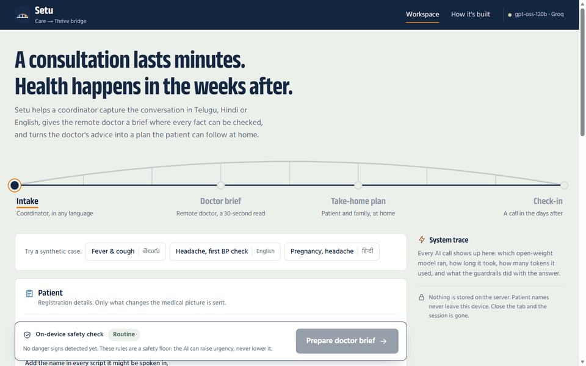
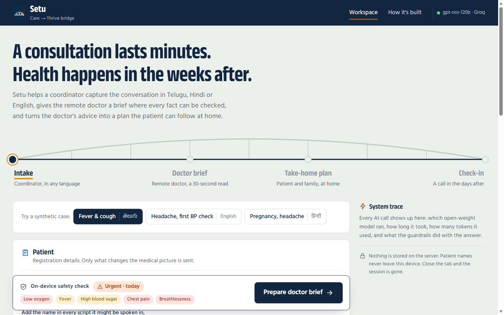
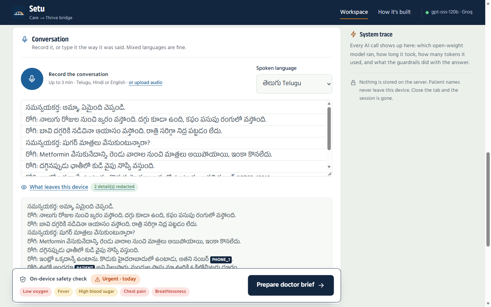
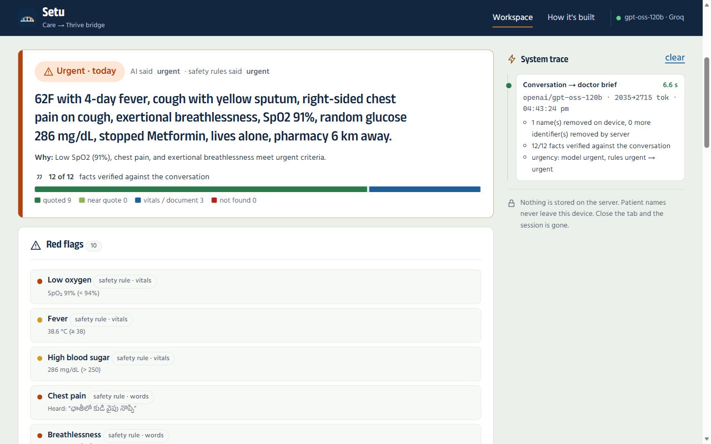
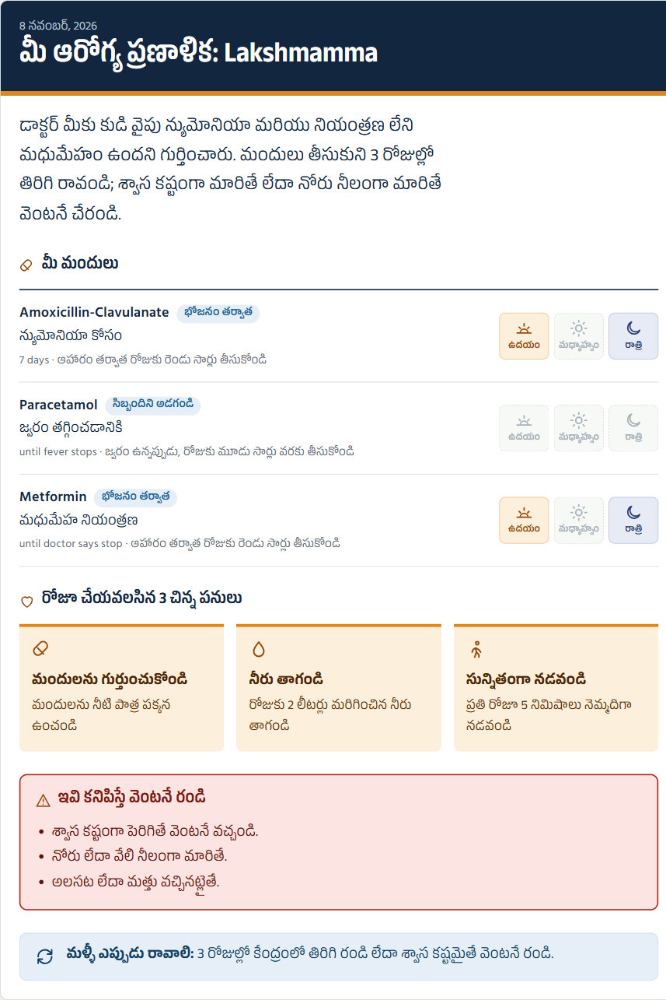
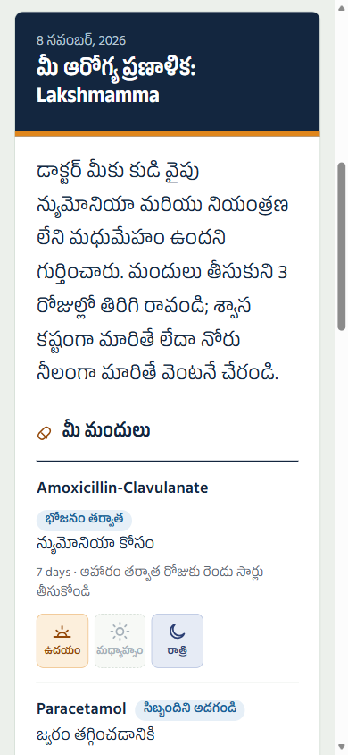
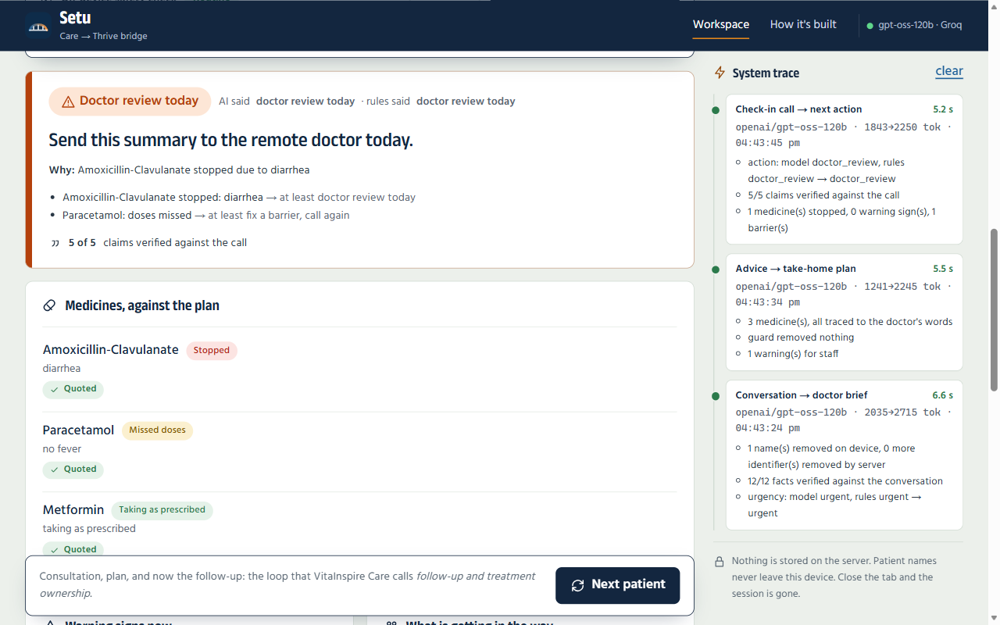
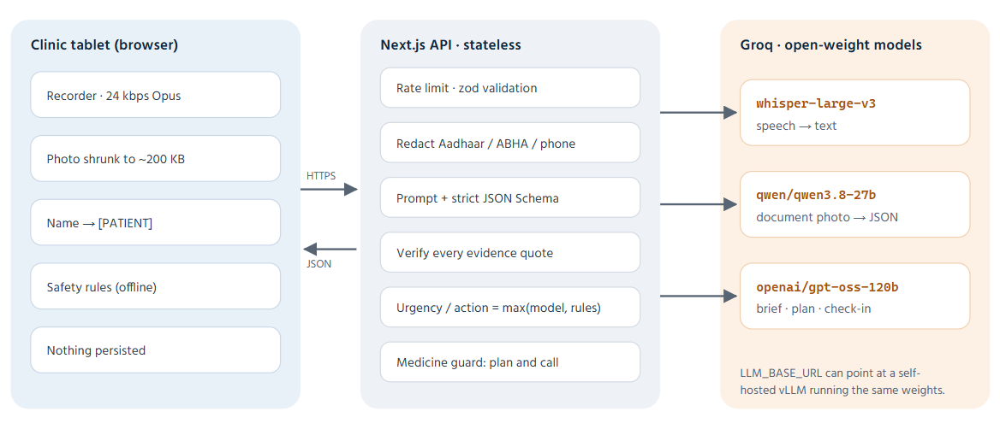

<div align="center">

# Setu · సేతు

**From a ten-minute consultation to the weeks after it.**

An AI bridge for rural clinics: Telugu, Hindi and English conversations become a doctor's brief that can be checked, a take-home plan a family can follow, and a follow-up call that catches patients before they are lost.

[Demo](#demo) · [How it works](#how-it-works) · [Safety](#safety-is-enforced-in-code) · [Run it](#run-it) · [Results](#test-and-evaluate) · [Limits](#known-limits)

<br>



<sub>A full run on a synthetic Telugu case, using live model responses. Every patient shown is made up.</sub>

</div>

---

## Why this exists

Setu is a working prototype built for [VitaInspire](https://www.vitainspire.ai/). It sits beside **VitaInspire Care**'s coordinator → remote doctor → patient workflow and hands off to **VitaInspire Thrive**, and it targets the gap VitaInspire names on its own site:

> "A consultation may last minutes, but health is shaped by the days and weeks between consultations… Thrive helps turn healthcare guidance into achievable everyday actions."

Patients are mostly lost **after** the consultation. An ICMR study of ASHA-supported telemedicine in Barmer, Rajasthan found that only about [36% of patients had follow-up visits with continuity of care](https://niirncd.icmr.org.in/uploads/policybriefs/1782386587_1.PolicyBrief_Telemedicine.pdf).

## Demo

To try it yourself, follow [Run it](#run-it) and pick one of the three synthetic cases on the first screen. No microphone is needed.

| Case | Language | What it exercises |
|---|---|---|
| Fever & cough | తెలుగు | Low SpO₂ the model must not downplay, a phone number to redact, an antibiotic stopped on day 2 |
| Headache, first BP check | English | Negations ("no chest pain") that must not raise an alarm, a refill that ran out |
| Pregnancy, headache | हिन्दी | Suspected pre-eclampsia, and a referral that never happened |

## How it works

### 1. Intake: the coordinator

Records the conversation in **Telugu, Hindi or English**, or takes typed notes, and flags anything Whisper was unsure about. Vitals are checked **on the device** as they are typed. A photo of an old prescription is read into structured data.



The patient's name is replaced **in the browser**, and the coordinator can see exactly what leaves the device.



### 2. Doctor brief: a 30-second read

Every symptom, medicine and red flag carries a **verbatim quote**, and code checks each quote against the transcript. The doctor sees the urgency, the reason for it, questions to ask first, and "considerations" that are explicitly not a diagnosis.



### 3. Take-home plan: the patient and family

A morning, afternoon and night medicine chart, **three small daily steps** fitted to the patient's real life, and warning signs, in the patient's language. Printable, with read-aloud. **Medicines can only come from the doctor's words.**

<p>

&nbsp;

</p>

### 4. Check-in call: days later

The coordinator calls the patient and records the call. Setu reads it **against the plan the patient went home with**: each medicine is marked taking, missed, stopped or not discussed, with a verified quote, plus warning signs, barriers and habits. It gives **one next action**: on track · fix a barrier and call again · doctor review today · come in now.



The three sample calls are the common ways patients are lost:

| Sample call | What happened | Setu's action |
|---|---|---|
| Telugu, day 3 | Antibiotic stopped on day 2 because of loose motions. Says *"ఆయాసం ఇప్పుడు లేదు"* (no breathlessness now) | Doctor review today. The denied breathlessness does **not** escalate |
| English, day 7 | BP tablets ran out and the shop is in town, so two days missed. *"No chest pain, no blurred vision"* | Fix the refill and call back, or doctor review. The denials do **not** escalate to "come in now" |
| Hindi, day 1 | The referral for suspected pre-eclampsia **never happened**; *"सिर में अभी भी बहुत दर्द है"* (still a bad headache) | Come in now / 108 |

## Safety is enforced in code

The model drafts. Plain, testable code decides what it is allowed to do.

| Guardrail | What it does | Where |
|---|---|---|
| **Safety floor** | Vitals thresholds plus spoken danger signs in 3 languages. It understands denials ("నొప్పి లేదు") and also "hasn't reduced" ("తగ్గలేదు"), which is not a denial. Final urgency = `max(model, rules)`, so the model can raise urgency but never lower it. | `src/lib/safety-rules.ts` |
| **Evidence checks** | Each quote is classed as quoted, near quote, vitals, document or **not found**. Not-found facts render in red. | `src/lib/grounding.ts` |
| **The AI cannot prescribe** | A medicine in the plan whose name or strength doesn't trace to the doctor's advice is removed and reported. | `src/lib/plan-guard.ts` |
| **Follow-up floor** | A danger sign → come in now. A stopped medicine or a patient getting worse → doctor review. Missed doses → call back within 3 days. "Taking it" needs a real quote from the call. | `src/lib/followup-guard.ts` |
| **Messages can't change treatment** | A suggested message that changes a medicine or dose is withheld, in English, Telugu and Hindi. | `src/lib/followup-guard.ts` |
| **Names stay on the device** | Replaced with `[PATIENT]` in the browser, including on text read from prescriptions. The server redacts Aadhaar, ABHA, phone and email again. | `src/lib/redact.ts` |
| **Strict structured output** | Zod → strict JSON Schema, then validation, with a repair pass that shows the model its errors. | `src/lib/schemas.ts`, `src/lib/server/llm.ts` |
| **No patient data in logs** | Upstream error bodies can echo patient text, so they are never logged or returned. | `src/lib/server/http.ts` |
| **Failure handling** | Per-IP rate limit, input caps, a 55 s budget per AI step including retries, plain-language errors, and offline detection that keeps the form. | `src/lib/server/*`, `src/lib/client.ts` |
| **Browser hardening** | CSP with `connect-src 'self'`, so the API key and model endpoints never reach the browser. No framing; mic and camera are same-origin only. | `next.config.mjs` |

**Built for the field:** 24 kbps Opus audio (about 540 KB for 3 minutes), photos shrunk on the device to about 200 KB, °F converted automatically, self-hosted fonts, no login on a shared tablet, nothing persisted.

## Architecture



All three models are **open-weight** and served by **Groq**. Set `LLM_BASE_URL` to point the same code at any OpenAI-compatible server (vLLM, Ollama) for data residency. The app's "How it's built" page compares this prototype with what production needs.

```
src/lib/            pure, shared by browser + server (redact, safety-rules, grounding, plan-guard, followup-guard, schemas)
src/lib/server/     server-only: model client, prompts, pipeline, HTTP wrapper
src/app/api/        transcribe · ocr · brief · plan · followup · health
src/components/     Intake / Brief / Plan / Check-in steps, recorder, document capture, trace panel
tests/              vitest unit tests
eval/               live evaluation harness
```

## Run it

Needs Node 20.9 or later and a free key from [console.groq.com/keys](https://console.groq.com/keys).

```bash
cp .env.example .env.local      # add GROQ_API_KEY
npm install
npm run dev                     # http://localhost:3000
```

## Test and evaluate

```bash
npm test          # 126 unit tests: redaction, safety rules (3 languages), grounding, plan guard, follow-up floor, LLM client
npm run eval      # live eval on 7 synthetic cases + 3 check-in calls → eval/results.md
```

Latest live run on `openai/gpt-oss-120b` via Groq ([full results](eval/results.md)):

| Metric | Result |
|---|---|
| Urgency in the expected band | 100% |
| Red-flag recall | 100% |
| Denied symptoms wrongly listed | 0 |
| Evidence verified against the transcript | 100% |
| Check-in action in the expected band | 100% |
| Per-medicine adherence read correctly | 100% |
| Median brief / plan / check-in latency | 5.0 s / 4.2 s / 5.1 s |

This is a small synthetic set, so it shows the pipeline behaves on known cases. It is not evidence of clinical accuracy.

## Deploy

**Vercel (recommended):** import the repo, set `GROQ_API_KEY`, deploy.

**Docker, Render or a partner VM:**

```bash
docker build -t setu . && docker run -p 3000:3000 -e GROQ_API_KEY=... setu
```

| Env var | Default |
|---|---|
| `GROQ_API_KEY` | required (or `LLM_API_KEY` for another server) |
| `LLM_BASE_URL` | `https://api.groq.com/openai/v1` (any OpenAI-compatible server) |
| `LLM_REASONING` | `on`. Set `off` for models that reject `reasoning_effort` |
| `LLM_TIMEOUT_MS` | `55000`, total for one AI step including retries. Raise for slow local GPUs |
| `TEXT_MODEL` | `openai/gpt-oss-120b` |
| `VISION_MODEL` | `qwen/qwen3.8-27b` |
| `STT_MODEL` | `whisper-large-v3` |
| `RATE_LIMIT` | `30` requests / 5 min / IP / endpoint |
| `TRUSTED_PROXY_HOPS` | `1`. Proxies that append to `x-forwarded-for`. Set `0` if the app is exposed directly |
| `NEXT_PUBLIC_AUTHOR_NAME`, `NEXT_PUBLIC_AUTHOR_URL`, `NEXT_PUBLIC_REPO_URL` | footer credits |

### Self-hosted open-weight models

`src/lib/server/llm.ts` uses strict JSON Schema, which both vLLM and Ollama support. To run the eval against a model on your own GPU:

```bash
ollama pull qwen2.5:3b
LLM_BASE_URL=http://localhost:11434/v1 LLM_API_KEY=ollama TEXT_MODEL=qwen2.5:3b LLM_REASONING=off EVAL_OUT=eval/results-local-qwen2.5-3b.md npm run eval
```

There is no local benchmark yet: the one recorded run could not reach its server.

## Known limits

- A name spoken in a different script from the one typed is not caught. Addresses and village names are not redacted. Audio and photos reach the speech and vision models unredacted.
- Keyword danger signs are a floor, not a classifier. The model's own red flags sit beside them.
- The plan guard checks medicine names and strengths. Timing and duration on the chart come from the model, so staff must check them against the advice.
- Telugu and Hindi output is marked as a **draft** for a staff member to check, with English beside it.
- Thresholds are illustrative. In production they belong to the partner's clinicians.
- The API routes have no login. The rate limit is per instance and best-effort, so a real deployment needs authentication.

---

<sub>Independent prototype. Not affiliated with or endorsed by VitaInspire or Digiswasthya. Not a medical device. All sample patients are synthetic.</sub>
